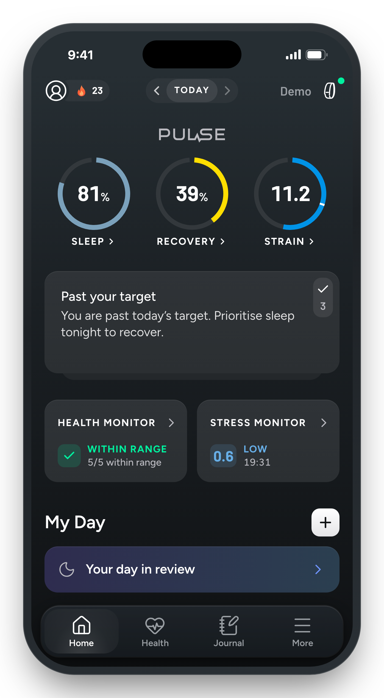
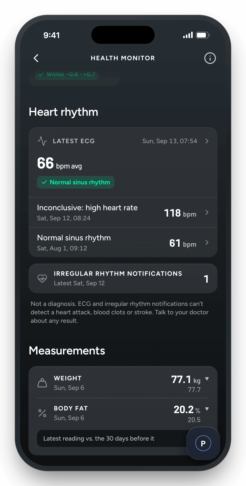
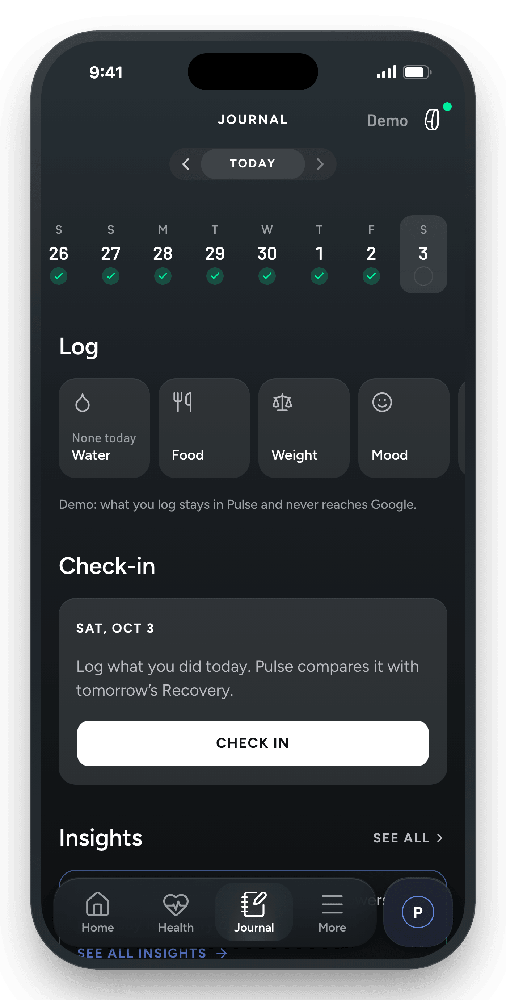

<div align="center">


# Pulse

**Recovery, strain and sleep from your Google Health data.**

Daily scores from what your Fitbit or Pixel Watch syncs to Google Health, on a server you own. Built on Fitbit Air. Free for personal use.

[](https://github.com/adityaongit/pulse/actions/workflows/ci.yml)
[](LICENSE)
[](https://pulse.portlabs.in)

[**Website**](https://pulse.portlabs.in) · [**Setup guide**](docs/setup.md) · [**Android app**](https://github.com/adityaongit/pulse-mobile) · [**Metrics**](https://pulse.portlabs.in/metrics/) · [**Screenshots**](docs/screenshots.md)





</div>

## Two ways to run it

| | **Pulse** (this repo) | **[Pulse Mobile](https://github.com/adityaongit/pulse-mobile)** |
|---|---|---|
| Runs | On your server, in the browser, as an installed app or in the [app shell](docs/mobile.md) | On your Android phone |
| Data | On your server, in Postgres | Only on the phone |
| Source | The Google Health API | Fitbit through Health Connect |
| Accounts | One server, many people, invite-only | None: one install is one person |
| Get it | [Setup guide](docs/setup.md) | [Download the APK](https://github.com/adityaongit/pulse-mobile/releases/latest) |

Pulse Mobile imports what Health Connect holds, up to the last 180 days. It does not share a Pulse server's history.

## What you get

- **Sleep, Recovery and Strain** each morning, with a Strain Target set by how recovered you are.
- **Pulse Age** and its pace: how old your body is behaving, and whether that is speeding up.
- **Stress Monitor** and **Energy Bank** through the day.
- **Health Monitor**: last night's vitals against your normal range, ECG readings and irregular rhythm notifications.
- **Journal**: log water, food, weight and mood, answer the questions you pick, and see what moves tomorrow's Recovery.
- **Trends** and weekly and monthly **Reports**, **My Dashboard**, and an optional **AI coach** with your own key.

Every score has a page with its inputs, weights, bands and limits: [the metrics](https://pulse.portlabs.in/metrics/) and [docs/algorithms](docs/algorithms).

## Quick start (demo, no Google account)

Demo mode generates 180 days of deterministic data for a shared demo user.

```sh
git clone https://github.com/adityaongit/pulse.git && cd pulse
pnpm install
cp .env.example .env                        # DATA_SOURCE=demo is already set
docker compose -f compose.dev.yaml up -d    # Postgres
pnpm dev                                    # http://localhost:3000, health check at /healthz
```

The database is created and migrated on boot, and the sync worker starts once (`[worker] started (source: seed)`).

## Run it with your own data

Pulse runs as one Docker container with its database in a volume, behind a tunnel or HTTPS reverse proxy.

1. Follow the [setup guide](docs/setup.md): Google Cloud OAuth client, Docker, HTTPS over Tailscale, troubleshooting.
2. Prefer Cloudflare Tunnel or your own reverse proxy? See [other setups](docs/other-setups.md).
3. Invite people, turn on the coach, update and back up: the [admin guide](docs/admin.md).

## Environment

Every variable is listed and explained in [`.env.example`](.env.example). It is validated at startup, and the server exits on invalid config.

- `DATA_SOURCE=google` switches to real data from the Google Health API. It needs `GOOGLE_CLIENT_ID`, `GOOGLE_CLIENT_SECRET` and `BETTER_AUTH_SECRET`. People sign up with a name, username, email and password (better-auth), sign in with the username or the email, and connect their own Google account from inside Pulse. Sign-up is invite-only by default: set `ADMIN_EMAILS` to your email, create your account, then invite people from the admin dashboard at `/admin` ([admin guide](docs/admin.md#invite-people)).
- The first sign-in asks for your birth date and sex (onboarding). Settings › Profile edits them.

## Install as an app

- **PWA:** install it from Chrome on Android or Add to Home Screen on iPhone. Notifications, offline, launch screens and rebranding: [docs/pwa.md](docs/pwa.md).
- **App shell for Android and iOS** (`mobile/`, Capacitor): connects to any Pulse server you enter on first launch: [docs/mobile.md](docs/mobile.md).
- **No server at all?** [Pulse Mobile](https://github.com/adityaongit/pulse-mobile) scores everything on your Android phone.

## Documentation

| Guide | What it covers |
|---|---|
| [Setup guide](docs/setup.md) | From the demo to your own data on a server |
| [Other setups](docs/other-setups.md) | Cloudflare Tunnel and reverse proxies |
| [Admin guide](docs/admin.md) | Invites, the coach, updates and backups |
| [Installed app (PWA)](docs/pwa.md) | Install, notifications, offline, rebranding |
| [App shell (Capacitor)](docs/mobile.md) | The Android and iOS shell: building, signing, releases |
| [Algorithms](docs/algorithms) | How each score is computed |
| [Technical details](docs/technical-details.md) | How a Pulse server works under the hood |
| [System design](docs/architecture/system-design.md) | The architecture as it is today |
| [Screenshots](docs/screenshots.md) | Every screen on a phone and a laptop |
| [AGENTS.md](AGENTS.md) | Commands, layout and rules for contributors and coding agents |

## Commands

| Command | What it does |
|---|---|
| `pnpm dev` | Dev server |
| `pnpm build` / `pnpm start` | Production build (standalone output) and server |
| `pnpm lint` | ESLint |
| `pnpm typecheck` | Generates Next route types, then `tsc --noEmit` |
| `pnpm test` / `pnpm test:watch` | Vitest (Node for `*.test.ts`, happy-dom for `*.test.tsx`) |
| `pnpm e2e` | Playwright |
| `pnpm db:generate` | Generates a migration in `drizzle/` from `src/server/db/schema.ts` |
| `pnpm pwa:assets` | Regenerates the app icons, shortcut icons and iOS launch screens ([docs/pwa.md](docs/pwa.md#rebrand-it-for-your-fork)) |

## Contributing and security

- [Contributing](CONTRIBUTING.md): how changes land (`main` is protected; every change is a pull request).
- [Security policy](SECURITY.md): report vulnerabilities privately.
- [Code of Conduct](CODE_OF_CONDUCT.md).

## License

[PolyForm Noncommercial 1.0.0](LICENSE). Use it, change it and share it for any noncommercial purpose. Selling it, or putting it inside a commercial product, is not allowed.

## Credits

- Design inspiration: the interface is inspired by the WHOOP app's look and flow. Pulse is a free, non-commercial community project by an independent developer. It is not affiliated with, endorsed by or competing with WHOOP, Inc., uses no WHOOP device, data, code or assets, and every score is computed from your own Google Health data. WHOOP is a trademark of WHOOP, Inc. If you represent WHOOP or any other company and have a concern, please email work.adityajindal@gmail.com and it will be changed or taken down.
- [noop](https://github.com/ryanbr/noop): the recovery, strain, sleep and readiness scoring is ported from its analytics engine.
- [Hælan](https://github.com/bardesss/haelan): its notes on how the Google Health API behaves saved a lot of trial and error.

